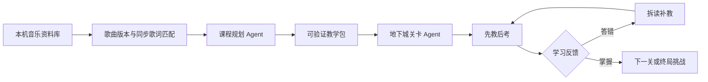

# VIBE RECORDS

> **Learn the language. Feel the music.**
> 一个把真实歌曲转化为个性化语言课程的 AI Agent。

VIBE RECORDS 面向喜欢音乐、却难以把课本知识带入真实语境的语言学习者。它连接用户自己的音乐资料库，从同步歌词中选择值得学习的表达，组织原声精听、拆读讲解、文化语境、理解检查和游戏化复习。

当前支持韩语、日语和中文，重点验证一条完整闭环：

```text
选择喜欢的歌 → 逐句听原声 → Agent 设计课程 → 先教后考
→ 根据错误补教 → 完成歌词地下城 → 带着新理解继续听歌
```

## 为什么做 VIBE RECORDS

传统语言应用往往缺少学习者真正关心的文化语境；普通音乐播放器又只展示歌词，不会把“听不懂”转化为可学习、可反馈的过程。

VIBE RECORDS 让歌曲本身成为课程材料：

- **真实原声**：点击歌词即可定位到对应片段，并在句末自动暂停。
- **语境教学**：同时解释表达的读音、基本义、整句含义、歌曲情绪与文化背景。
- **先教后考**：先完成拆读和带提示检查，再进入无提示挑战。
- **自适应反馈**：答错后回到具体薄弱点补教，而不是只显示正确答案。
- **Agent 编排**：模型不是单独回答问题，而是选择学习目标、生成教学包、设计关卡并决定下一步。

## 核心体验

### 1. Listen · 听见真实表达

连接自己的音乐资料库，载入与歌曲版本匹配的同步歌词。用户可以逐句播放、跳转、暂停，并反复聆听歌手的真实发音。

### 2. Learn · 理解歌词语境

Agent 从真实歌词中选择可验证的学习点，给出拆读、词义、整句翻译、歌曲语境和文化说明。所有课程内容都必须引用实际歌词行，无法通过校验的课程不会进入学习流程。

### 3. Play · 在反馈中掌握

学习者完成带提示检查后进入 19×9 歌词地下城，通过听音辨词、NPC 情境题、知识卡和串词成句终关巩固表达。答错会触发针对性补教，通过后继续下一关。

## 五分钟开始体验

### 环境要求

- Node.js 20 或更高版本
- macOS 或 Windows
- 用户自己的音乐客户端与歌曲资料库
- 一个兼容 Chat Completions 或 Responses 的模型 API

### 1. 克隆并启动

```sh
git clone https://github.com/oppphantom/vibe-language-agent.git
cd vibe-language-agent
npm ci
npm start
```

打开 <http://127.0.0.1:8767/>。

> 服务只监听 `127.0.0.1`，不会作为公网服务开放。若 8767 端口已被占用，可使用 `PORT=8768 npm start`。

### 2. 连接模型

1. 打开页面顶部的“模型设置”。
2. 选择 OpenAI Chat Completions、火山方舟 Responses 或自定义兼容接口。
3. 填写接口地址、模型名称和 API Key。
4. 点击“测试并保存本次配置”。
5. 连接成功后返回音乐页。

系统会先执行一次最小真实调用，确认接口可用后才保存配置。API Key 只存在当前 Node.js 进程内存中，不进入浏览器存储、磁盘、日志或 Git；关闭服务即清除，页面也无法读回完整密钥。

### 3. 选择歌曲并生成课程

1. 连接音乐来源并读取歌曲。
2. 选择一首歌，打开“查看歌词与逐句播放”。
3. 确认同步歌词与当前歌曲版本匹配。
4. 点击任意歌词行，测试原声定位与句末暂停。
5. 点击“生成歌曲学习地图”。
6. 跟随“分析歌词 → 生成教学包 → 设计关卡”的进度进入课程。

## 音乐平台支持

| 平台 | macOS | Windows | 当前能力 |
| --- | --- | --- | --- |
| Apple Music / Mac「音乐」 | 支持 | — | 读取个人资料库、选择歌曲、逐句定位、句末暂停、跨歌曲 Discover |
| QQ 音乐 | 支持当前播放 | 支持 | 当前歌曲控制；Windows 可导入公开歌单并直接点播 |
| 网易云音乐 | 支持当前播放 | 支持 | 当前歌曲控制；Windows 可只读导入本机歌单和队列并直接点播 |

macOS 的 QQ 音乐和网易云音乐控制需要 `nowplaying-cli`。Windows 的 QQ 音乐无需额外启动参数；网易云音乐需要先完全退出客户端，再通过本机回环调试端口启动：

```powershell
& 'C:\Program Files\NetEase\CloudMusic\cloudmusic.exe' --remote-debugging-port=9222
npm start
```

该端口只绑定本机。项目不会上传个人歌单、播放记录或音乐文件。

## Agent 如何工作



课程生成不是一段固定提示词直接输出页面。系统会依次完成：

1. 检查歌词数量、时间戳和来源。
2. 从真实歌词中选择 2–5 个可学习目标。
3. 为每个目标生成读音、基本义、语境、文化说明与带解释的三选一检查。
4. 校验所有歌词引用、答案、知识卡和词块顺序。
5. 根据歌曲内容设计 note、NPC、card 与最终字符关卡。
6. 根据学习者的回答决定补教、重试或进入下一关。

模型输出若引用不存在的歌词行、缺少可验证答案或不符合课程契约，服务端会拒绝创建课程。

## 系统设计

| 模块 | 作用 |
| --- | --- |
| `frontend/` | 音乐资料库、同步歌词、模型设置、教学流程与地下城界面 |
| `backend/media/` | 音乐客户端桥接、歌词来源、版本匹配和逐句播放 |
| `backend/agent/` | 模型适配、课程规划、教学状态、反馈与关卡生成 |
| `shared/` | 歌曲、歌词、课程、会话和答案的运行时契约 |
| `tests/` | 课程校验、播放边界、幂等、安全与多语言流程测试 |

时间统一使用毫秒。正确答案、评分依据和学习状态保存在服务端；客户端不能通过页面数据读取答案键。动态课程和学习会话暂存在本机 Node.js 进程内存中，服务重启后失效。

更详细的设计见 [架构说明](docs/ARCHITECTURE.md) 与 [API 契约](docs/API_CONTRACT.md)。

## 模型接口

推荐直接在网页“模型设置”中完成连接。需要固定开发环境时，也可以在仓库根目录使用已被 Git 忽略的 `.env`：

```sh
VIBE_MODEL_ENDPOINT=https://api.openai.com/v1/chat/completions
VIBE_MODEL_NAME=你的模型名称
VIBE_MODEL_API_KEY=你的密钥
VIBE_MODEL_API_TYPE=chat_completions
```

Responses 接口示例：

```sh
VIBE_MODEL_ENDPOINT=https://ark.cn-beijing.volces.com/api/v3/responses
VIBE_MODEL_NAME=你的模型名称
VIBE_MODEL_API_KEY=你的密钥
VIBE_MODEL_API_TYPE=responses
```

服务端只接受受信任的 HTTPS 模型地址，并拒绝带账号密码、查询参数、片段、本机地址或直接 IP 的 Endpoint。

## 网络代理

如果本机访问歌词或模型服务需要 HTTP 代理，可按自己的端口启动：

```sh
NODE_USE_ENV_PROXY=1 \
HTTPS_PROXY=http://127.0.0.1:7890 \
HTTP_PROXY=http://127.0.0.1:7890 \
npm start
```

代理配置只影响当前服务进程，不会写入仓库。

## 开发与验证

```sh
npm run check
npm run smoke

# 可选：使用 .env 中的真实模型执行最小联调
npm run smoke:model
```

- `npm run check`：检查 JavaScript 语法并运行自动测试。
- `npm run smoke`：在临时本机端口走通多语言 Agent、教学、补教、关卡和完成状态。
- `npm run smoke:model`：使用开发者自己的模型配置验证真实模型链路。

参与开发前请阅读 [中文贡献指南](CONTRIBUTING.md)。

## 数据与版权边界

仓库不包含商业歌曲音频、完整歌词缓存、个人音乐资料库、Cookie 或 API Key。音乐播放由用户已经安装并有权使用的本机客户端完成；歌词在运行时按歌曲版本检索，仅用于个人学习流程。

可访问某项外部数据不等于拥有重新分发权。贡献代码时请勿提交商业音频、完整歌词、个人歌单导出或真实密钥。

## 当前边界

- 同步歌词能否匹配取决于歌曲版本、平台元数据和歌词来源。
- 不同音乐客户端提供的播放状态和定位精度存在差异。
- 跨歌曲语境 Discover 当前主要支持 Mac「音乐」。
- 当前不提供语音发音评分、云端账号、长期进度保存或跨设备同步。
- 模型生成的语言与文化解释仍应结合歌词证据审慎使用。

## 常见问题

**为什么“生成歌曲学习地图”不可点击？**

请先在“模型设置”完成测试连接，并载入至少四行同步歌词。

**为什么找不到同步歌词？**

常见原因是歌词库没有该歌曲、网络不可用，或资料库版本与歌词版本的时长差异过大。项目不会用其他版本的歌词冒充匹配成功。

**为什么课程生成被拒绝？**

当模型引用不存在的歌词行、缺少合法学习目标或生成了无法由歌词验证的答案时，服务端会拒绝课程，避免展示看似完整但不可核验的内容。

**为什么重启后配置和学习进度消失？**

模型密钥、动态课程和学习会话目前只保存在本机进程内存中，这是当前版本的隐私与安全设计。

**其他成员会看到我的歌曲吗？**

不会。每台电脑读取自己的音乐客户端和个人资料库，仓库不包含任何成员的歌曲数据。

---

VIBE RECORDS 希望证明：语言学习不一定从课程表开始，也可以从一首真正喜欢的歌开始。
